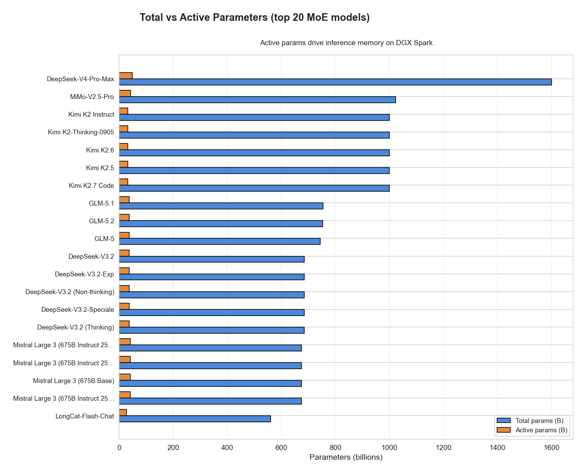
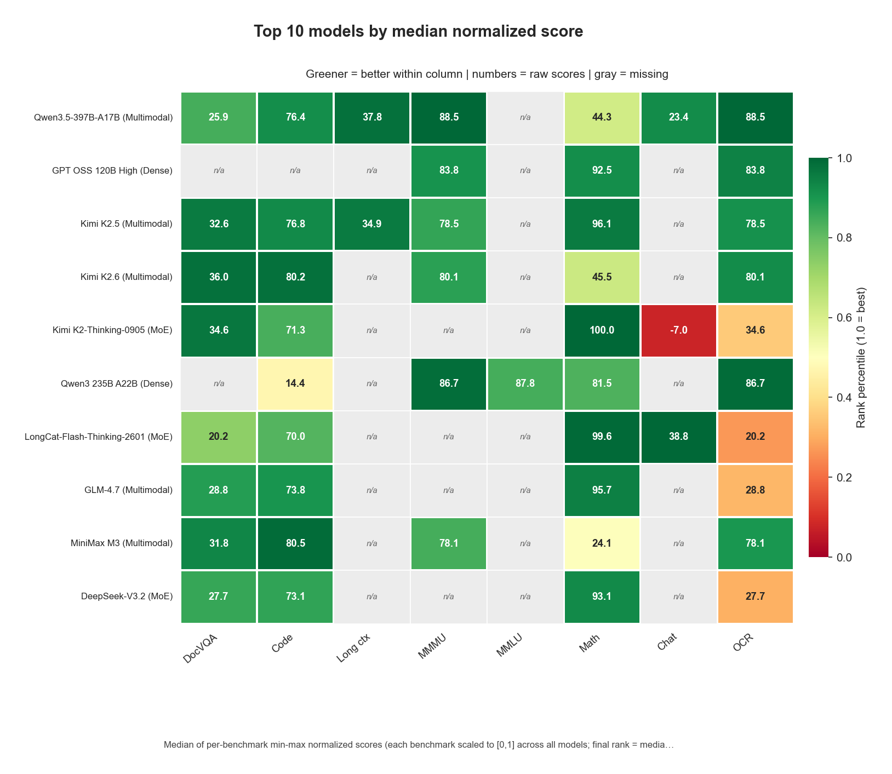
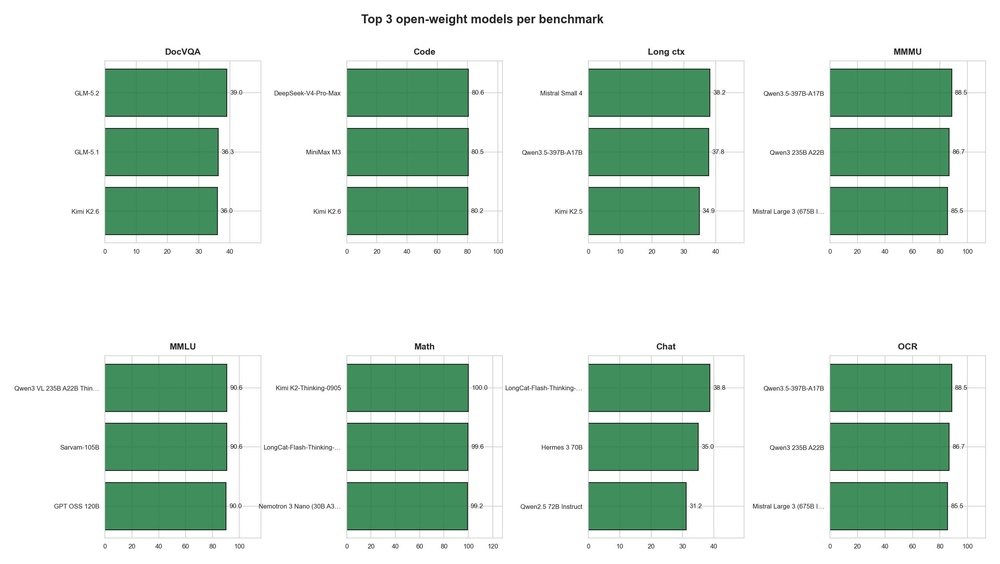

# Model survey for UD chatbot on DGX Spark

Phase 1 analysis: pick strong open models for a UD on prem chatbot, then check which ones can actually be served on Spark hardware.

## What we did

We scored 190 open weight models on 8 benchmarks that matter for a UD on prem chatbot (documents, code, long context, multimodal, general knowledge, math, conversation, OCR).

We ranked models by their median score across those benchmarks. Then we checked which top models can realistically be served on one DGX Spark node: they need a HuggingFace model id, at least 3 benchmark scores, and about 110 GB or less for model weights at bf16 (using active parameters for MoE models).

## What the team already picked

`configs/models.yaml` has 7 models for Spark serving tests. All 7 are in our CSV. Their best median score in our ranking is 0.714. None of them land in the overall top 10.

* llama3.1-8b (Llama 3.1 8B Instruct): score 0.163, rank #128
* nemotron-nano-8b (Llama 3.1 Nemotron Nano 8B V1): score 0.466, rank unranked
* gemma3-27b (Gemma 3 27B): score 0.305, rank #109
* qwen3-32b (Qwen3 32B): score 0.548, rank unranked
* nemotron3-nano-30b-a3b-fp8 (Nemotron 3 Nano (30B A3B)): score 0.480, rank #81
* nemotron-super-49b-fp8 (Llama-3.3 Nemotron Super 49B v1): score 0.714, rank unranked
* llama3.3-70b (Llama 3.3 70B Instruct): score 0.346, rank #102

## Top 10 by UD benchmarks

1. **Qwen3.5-397B-A17B** score 0.960. can run on Spark. 34 GB weights. `Qwen/Qwen3.5-397B-A17B`.
2. **GPT OSS 120B High** score 0.934. hard to serve on one Spark node. 234 GB weights. `openai/gpt-oss-120b`.
3. **Kimi K2.5** score 0.918. can run on Spark. 64 GB weights. `moonshotai/Kimi-K2.5`.
4. **Kimi K2.6** score 0.914. can run on Spark. 64 GB weights. `moonshotai/Kimi-K2.6`.
5. **Kimi K2-Thinking-0905** score 0.911. can run on Spark. 64 GB weights. `moonshotai/Kimi-K2-Thinking`.
6. **Qwen3 235B A22B** score 0.908. hard to serve on one Spark node. 470 GB weights. `Qwen/Qwen3-235B-A22B`.
7. **LongCat-Flash-Thinking-2601** score 0.898. can run on Spark. 54 GB weights. `meituan-longcat/LongCat-Flash-Thinking-2601`.
8. **GLM-4.7** score 0.880. can run on Spark. 72 GB weights. `zai-org/GLM-4.7`.
9. **MiniMax M3** score 0.876. hard to serve on one Spark node. memory unknown. no HuggingFace id.
10. **DeepSeek-V3.2** score 0.867. can run on Spark. 74 GB weights. `deepseek-ai/DeepSeek-V3.2`.

## Spark practical models from the top 10

7 of 10 top models look practical on one Spark node.

* **Qwen3.5-397B-A17B** (score 0.960, 34 GB, `Qwen/Qwen3.5-397B-A17B`)
* **Kimi K2.5** (score 0.918, 64 GB, `moonshotai/Kimi-K2.5`)
* **Kimi K2.6** (score 0.914, 64 GB, `moonshotai/Kimi-K2.6`)
* **Kimi K2-Thinking-0905** (score 0.911, 64 GB, `moonshotai/Kimi-K2-Thinking`)
* **LongCat-Flash-Thinking-2601** (score 0.898, 54 GB, `meituan-longcat/LongCat-Flash-Thinking-2601`)
* **GLM-4.7** (score 0.880, 72 GB, `zai-org/GLM-4.7`)
* **DeepSeek-V3.2** (score 0.867, 74 GB, `deepseek-ai/DeepSeek-V3.2`)

These top 10 models are **not** practical on one Spark node:

* **GPT OSS 120B High**: too large (234 GB estimated weights)
* **Qwen3 235B A22B**: too large (470 GB estimated weights)
* **MiniMax M3**: no HuggingFace id

## Models we recommend adding to `configs/models.yaml`

These score higher than the current team list and look practical on Spark. We think the team should serve test them in Phase 2.

* **Qwen3.5-397B-A17B** score 0.960, `Qwen/Qwen3.5-397B-A17B`, about 34 GB weights
* **Kimi K2.5** score 0.918, `moonshotai/Kimi-K2.5`, about 64 GB weights
* **Kimi K2.6** score 0.914, `moonshotai/Kimi-K2.6`, about 64 GB weights
* **Kimi K2-Thinking-0905** score 0.911, `moonshotai/Kimi-K2-Thinking`, about 64 GB weights
* **LongCat-Flash-Thinking-2601** score 0.898, `meituan-longcat/LongCat-Flash-Thinking-2601`, about 54 GB weights
* **GLM-4.7** score 0.880, `zai-org/GLM-4.7`, about 72 GB weights
* **DeepSeek-V3.2** score 0.867, `deepseek-ai/DeepSeek-V3.2`, about 74 GB weights

## Notes

Some benchmarks use proxy columns from the leaderboard CSV (for example Vision stands in for DocVQA).
Scores are normalized per benchmark so different scales can be compared.
Memory numbers are estimates. Real serving also needs KV cache headroom.
Next step: run the recommended models through the repo serving benchmark on Spark.

## Plots

### 1. Total vs active parameters

MoE models use far fewer active params than total size.

### 2. Top 10 heatmap

Green is better within each benchmark column.

### 3. Top 3 per benchmark

Best model on each task.

